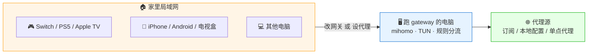

# LAN Proxy Gateway

[](https://github.com/achieve-jsy/lan-proxy-gateway/releases)
[](https://go.dev/)
[]()
[](LICENSE)

> **把一台电脑变成整屋的代理网关** —— 一台机器配好代理，整屋设备（手机 / Switch / PS5 / Apple TV / 智能电视）一起用，**不用每台都装代理 App**。

中文菜单 · 一键安装 · 实时终端面板 · 链式代理。基于 [mihomo](https://github.com/MetaCubeX/mihomo)（Clash.Meta）。English: [README_EN.md](README_EN.md)



## 这是什么

大多数代理客户端（Clash Verge / V2RayN / Mihomo Party）解决的是「本机怎么上网」。
家里还有一堆**装不了代理 App 的设备**：Switch、PS5、Apple TV、智能电视、车机。
它们只有两个开关可以调：**网关**和 **DNS**。

这个项目就是为这两个开关准备的：在一台 macOS / Linux 电脑上跑起 mihomo 的 TUN 模式，
把它自己变成局域网的网关，整屋设备改个网关地址就全部走代理；改不了网关的设备走 HTTP 代理也一样能用。

顺带把日常最烦的几件事一起做了：代理源异常自动切直连保命、机场 + 住宅 IP 的链式代理一键预设、
终端里一个实时面板看网速和在线设备、全套无交互命令给脚本和 AI agent 用。

## 快速开始

### 1. 安装

```bash
# macOS / Linux
curl -fsSL https://raw.githubusercontent.com/achieve-jsy/lan-proxy-gateway/main/install.sh | bash

# Windows（管理员 PowerShell）
irm https://raw.githubusercontent.com/achieve-jsy/lan-proxy-gateway/main/install.ps1 | iex
```

装完自动进入配置向导（问代理源 → 启动 → 问开机自启）。
国内访问 GitHub 慢可以设 `GITHUB_MIRROR=https://你的镜像/`，或先在已跑着 Clash 的机器上 `export HTTP_PROXY=http://127.0.0.1:7897` 再执行。

### 2. 启动

```bash
sudo gateway start     # macOS / Linux
gateway start          # Windows（管理员终端，无需 sudo）
```

控制台会显示**本机 LAN IP** 和**代理端口**，下一步要填的就是这两个。

### 3. 接入设备

| 你的设备 | 选哪种 | 填什么 |
|---|---|---|
| 🎮 Switch / PS5 / Apple TV / 智能电视 | 改网关（仅 macOS / Linux） | 网关 + DNS = gateway 电脑 IP |
| 📱 iPhone / Android / 浏览器 | 设代理 | HTTP 代理：`gateway IP : 17890` |
| 💻 本机也走规则 | TUN | 菜单开 TUN 自动生效；macOS 按 `L` 一键切 DNS |

> ⚠️ **Windows 家用版限制**：没有 RRAS / ICS 受限，改网关方式走不通。
> 所有设备只能走「设代理」；Switch / PS5 这类不能设代理的设备在 Windows 上无解，请改用 Linux / macOS 主机或软路由。

详细步骤（含 Switch / PS5 / 电视）：[docs/device-setup.md](docs/device-setup.md)

## 核心能力

| 能力 | 说明 |
|---|---|
| 🌐 **LAN 透明网关** | 设备改网关 + DNS 就接管（macOS / Linux）；不能改网关的设备走 HTTP 代理（全平台） |
| 🔗 **三种代理源** | 机场订阅 URL / 本地 `.yaml` / 本机已在跑的 Clash 端口（二次代理） |
| 🏠 **链式代理预设** | 一键「机场起飞 + 住宅 IP 落地」，AI 网站看到的是家庭宽带 ASN |
| 📟 **实时终端面板** | 首页自动刷新：网速柱状图 + 稳定性健康条 + 在线设备一屏看全；`/` 斜杠命令快速导航 |
| 🤖 **脚本 / Agent 友好** | 全套无交互命令 `gateway config` / `gateway node` / `gateway status --json`，配 `skills/lan-proxy-gateway-ops` 可被 Claude Code 等 agent 驱动 |
| 🔐 **代理服务认证** | 局域网 HTTP / SOCKS5 `mixed-port` 可独立开关，可设用户名 / 密码；TUN 可同时开启 |
| ⚡ **代理源 supervisor** | 订阅 / 文件源异常时自动切直连保命；本机单点代理只监控端口，避免误切 |
| 🎯 **规则系统** | 内置 LAN 直连 / 中国直连 / Apple / Nintendo / 广告拦截；自定义规则可指定 `Proxy` 或任意策略组 |
| 📊 **节点测速** | 切节点页面自动并发测延迟，按速度升序 |
| 🗒️ **中文日志视图** | mihomo 英文日志翻译成中文（`🟡 TCP 直连 xxx → 超时`） |

## 适合谁

- 🎮 **想给 Switch / PS5 / Apple TV / 智能电视用代理**：这些设备没有代理 App 可装，只能改网关。
  典型玩法：Switch 联机加速、eShop / PSN 下载加速、Steam / Epic 下载加速
- 📱 **iPhone / iPad 不想装 VPN App**：家里电脑做共享代理，手机 Wi-Fi 改下代理就能用
- 👨‍👩‍👧 **全家多台设备共用一份订阅**：订阅只放在 gateway 这台，其他设备零配置接入
- 🔁 **给 Clash Verge / V2RayN / Mihomo Party 补功能**：复用现有节点池，加「链式代理 + 整屋 LAN 共享 + TUN 网关」

## 跟 Clash Verge 的「局域网共享」有什么区别

| 项目 | Clash Verge LAN 共享 | LAN Proxy Gateway |
|---|---|---|
| 代理层级 | 应用层 HTTP 代理 | 网络层透明代理 + TUN |
| 设备配置 | 每台填代理 IP:Port | 改网关 + DNS 即可（无代理设置的设备唯一解） |
| Switch / PS5 / 电视 | 多数不支持代理设置 → 用不了 | ✅ 原生支持 |
| App 是否能察觉 | 容易被探测 | 接近真路由器 |
| 链式代理 | ❌ | ✅ 一键预设 |

## 常用命令

| 命令 | 作用 |
|---|---|
| `gateway` | 打开主菜单 / 实时面板 |
| `gateway status --json` | 机器可读的状态输出 |
| `gateway config` | 非交互式改配置 |
| `gateway node` | 列出 / 切换节点 |
| `gateway update [版本]` | 升级或回退 |
| `sudo gateway service install` | 安装成系统服务 / 开机自启 |

完整命令：[docs/commands.md](docs/commands.md)

## 文档

**接入设备**：[device-setup.md](docs/device-setup.md) · [phone](docs/phone-setup.md) · [switch](docs/switch-setup.md) · [ps5](docs/ps5-setup.md) · [appletv](docs/appletv-setup.md) · [tv](docs/tv-setup.md)

**玩法与排错**：[scenarios.md](docs/scenarios.md)（含 AI 住宅 IP 链式代理教程） · [faq.md](docs/faq.md)

**进阶**：[advanced.md](docs/advanced.md)（配置 schema） · [architecture.md](docs/architecture.md)（三层架构） · [release-process.md](docs/release-process.md) · [versioning.md](docs/versioning.md)

## 升级 / 回退

```bash
gateway update                 # 升级到最新（推荐：不预先 sudo）
gateway update v3.4.3          # 升级或回退到指定版本
```

> 推荐**不预先 sudo**：程序先在用户身份下查询和下载（保留你的 `HTTPS_PROXY` 等代理变量），替换二进制阶段才请求 sudo。
> `sudo gateway update` 仍可用，但 macOS 默认 sudoers 会剥掉代理变量，导致拉不到 GitHub。

## 从源码构建

```bash
git clone https://github.com/achieve-jsy/lan-proxy-gateway.git
cd lan-proxy-gateway
make build        # 产物：bin/gateway
sudo ./bin/gateway start
```

## License

[MIT](LICENSE) © 2025-2026 achieve-jsy

基于 [mihomo](https://github.com/MetaCubeX/mihomo) 内核 + [metacubexd](https://github.com/MetaCubeX/metacubexd) 控制台。

## Star History

[](https://star-history.com/#achieve-jsy/lan-proxy-gateway&Date)

觉得有用就点个 Star ⭐ 支持一下吧～